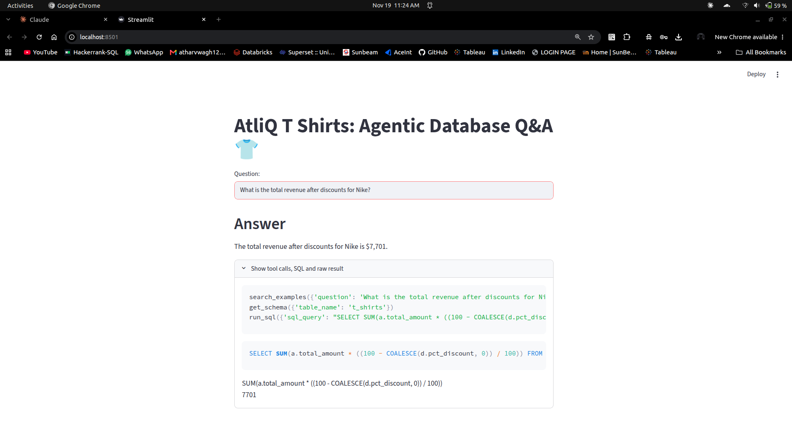
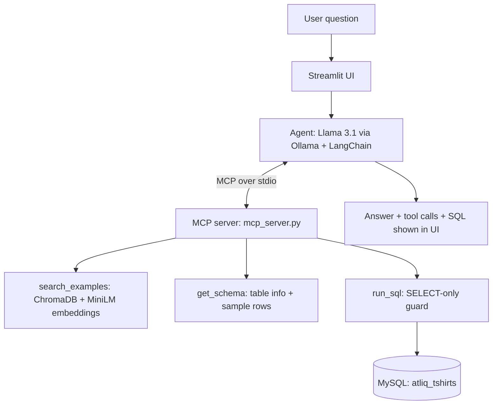

# AtliQ T-Shirts: Agentic Text-to-SQL Assistant (RAG + MCP)

Ask questions about a retail t-shirt database in plain English. A local Llama 3.1 agent retrieves similar solved examples (RAG), reads the schema, writes a MySQL query, runs it safely, and answers in natural language. All database and retrieval logic is exposed as tools through a custom **MCP (Model Context Protocol) server**, and the LLM decides which tool to call and when.



## Features

- **Agentic tool calling**: the LLM chooses between `search_examples`, `get_schema` and `run_sql`, and can read errors and retry.
- **RAG for SQL**: few-shot question/SQL pairs are embedded (MiniLM) and stored in ChromaDB; the 3 most similar examples are retrieved for each question.
- **Custom MCP server**: tools are defined once and can be used by any MCP client, independent of the LLM or UI.
- **Safe by design**: read-only database user, SELECT-only validator, row limit.
- **Transparent UI**: Streamlit shows the answer plus the tool calls, SQL and raw result.
- **Fully local**: Llama 3.1 runs through Ollama, so no API keys are needed.

## Architecture



**Typical run:** `search_examples` → `get_schema` → `run_sql` → (retry on `ERROR`) → plain-English answer.

## Tech stack

Python 3.10+, Llama 3.1 (Ollama), LangChain / LangGraph, MCP (`mcp`, `langchain-mcp-adapters`), ChromaDB, HuggingFace sentence-transformers, MySQL, SQLAlchemy + PyMySQL, Streamlit.

## Project structure

```
├── main.py              # Streamlit app (agent version)
├── agent_service.py     # Keeps one persistent MCP session + agent for Streamlit
├── agent.py             # Agent definition, system prompt, CLI trace runner
├── mcp_server.py        # MCP server: get_schema, run_sql, search_examples
├── sql_guard.py         # SQL safety checks and result formatting
├── few_shots.py         # Few-shot question/SQL examples used for RAG
├── langchain_helper.py  # Original non-agent chain (baseline)
├── main_chain.py        # Streamlit app for the baseline chain
├── test_mcp_client.py   # Tests the MCP tools without an LLM
├── requirements.txt
└── .env.example
```

## Setup

### 1. Clone and install

```bash
git clone https://github.com/waghatharvsb/retailqa-llm-sql-assistant.git
cd retailqa-llm-sql-assistant
pip install -r requirements.txt
```

### 2. Create the database

Create the `atliq_tshirts` database with the `t_shirts` and `discounts` tables and load the sample data:

```bash
mysql -u root -p < schema.sql
```
SCHEMA:
 
CREATE TABLE discounts (
        discount_id INTEGER NOT NULL AUTO_INCREMENT, 
        t_shirt_id INTEGER NOT NULL, 
        pct_discount DECIMAL(5, 2), 
        PRIMARY KEY (discount_id), 
        CONSTRAINT discounts_ibfk_1 FOREIGN KEY(t_shirt_id) REFERENCES t_shirts (t_shirt_id), 
        CONSTRAINT discounts_chk_1 CHECK ((`pct_discount` between 0 and 100))
)

Then create a **read-only** user for the app:

```sql
CREATE USER 'qa_app'@'%' IDENTIFIED BY 'your_password';
GRANT SELECT ON atliq_tshirts.* TO 'qa_app'@'%';
FLUSH PRIVILEGES;
```

### 3. Configure environment

```bash
cp .env.example .env
```

Edit `.env`:

```
DB_HOST=localhost
DB_PORT=3306
DB_USER=qa_app
DB_PASSWORD=your_password
DB_NAME=atliq_tshirts
```

### 4. Start Ollama and pull the model

```bash
ollama pull llama3.1
```

### 5. Check the MCP server (optional but recommended)

```bash
python3 test_mcp_client.py 2>/dev/null
```

You should see the three tools listed, the schema, a stock total, and an `ERROR` for the blocked `DROP TABLE` test.

### 6. Run the app

```bash
streamlit run main.py
```

The first question is slower because the embedding model loads once; later questions are faster because the MCP session stays open.

## Example questions

- How many Levi t-shirts are in stock?
- What is the total revenue after discounts for Nike?
- How many white Van Heuson shirts are in size M?
- Which t-shirts are out of stock?

## Security

- The app connects with a **read-only MySQL user** (`SELECT` only).
- `run_sql` accepts a **single `SELECT`/`WITH` statement** only. It rejects semicolons, SQL comments and keywords such as `INSERT`, `UPDATE`, `DELETE`, `DROP`, `ALTER`, `TRUNCATE`, `GRANT`, `SLEEP`.
- Results are capped at **50 rows**.
- The agent is limited to 12 steps per question to prevent endless loops.
- The checks live inside the MCP tool, so they apply no matter what the LLM generates.

## Evaluation

_To be added: accuracy of the baseline chain vs. the MCP agent on a custom question set._

| Approach | Correct answers | Avg. latency |
|---|---|---|
| Baseline chain (`main_chain.py`) | – | – |
| MCP agent (`main.py`) | – | – |

## Limitations

- Llama 3.1 8B is not fully reliable at tool calling: it may invent tool arguments or give wrong SQL on multi-step questions, so tool errors are returned to the model and the number of retries is capped.
- Business rules (brand spellings, revenue formula, discount join) are written in the system prompt and few-shot examples; new rules need new examples.
- Runs locally and needs Ollama and a running MySQL instance.

## Roadmap

- [ ] Docker Compose (app + MySQL)
- [ ] Evaluation set and accuracy comparison
- [ ] Deployment with a hosted Llama API
- [ ] Conversation memory for follow-up questions

## License

MIT

## Run with Docker

```bash
cp .env.example .env     # fill in DB_USER, DB_PASSWORD, DB_NAME, MYSQL_ROOT_PASSWORD
ollama pull llama3.1     # Ollama runs on the host and must listen on 0.0.0.0
docker compose up --build
```

Open http://localhost:8501. Three containers start: `mysql` (database), `mcp` (MCP server, internal only) and `app` (Streamlit + agent). Only the `mcp` container has database credentials.